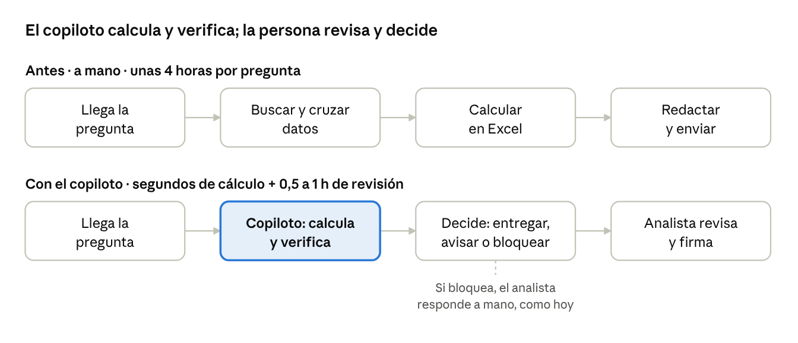
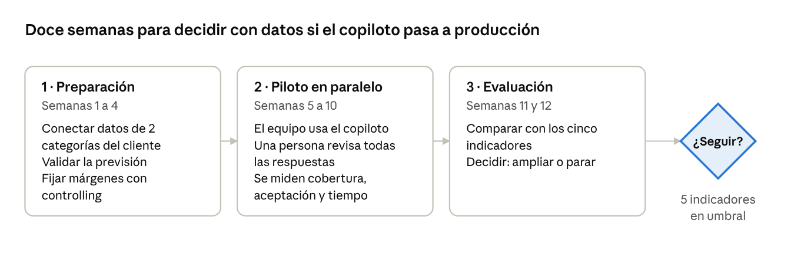

# Business case — Copiloto comercial con gobernanza

## Resumen

**Recomendación: pilotar el copiloto 12 semanas en dos categorías antes de decidir su paso a producción.** Incluso en el escenario conservador, el copiloto libera unas 135 horas de analista al mes (6.750 € al mes a 50 €/h) y recupera la inversión del piloto en unos 5 meses.

- Hoy, un equipo que recibe 150 preguntas comerciales al mes dedica unas 600 horas (3,75 personas a tiempo completo) a responderlas a mano.
- El caso se sostiene mientras el copiloto cubra al menos el 8 % de las preguntas; el escenario conservador supone el 30 %.
- El coste del modelo de lenguaje es residual (menos de 5 € al mes). Los costes reales son el desarrollo del piloto, la supervisión y el mantenimiento.
- El ahorro es **capacidad liberada**: horas que el equipo dedica a análisis de más valor. Solo se convierte en ahorro de caja si se reasigna o se deja de contratar.

## Contexto y alcance

El caso se plantea como lo presentaría una consultora de Revenue Growth Management a un retailer: el equipo comercial recibe preguntas recurrentes sobre ventas y promociones, y cada una exige buscar datos, calcular y redactar una respuesta.

El copiloto responde a tres tipos de pregunta, con datos de 8 categorías:

| Pregunta | Herramienta | Qué entrega |
| --- | --- | --- |
| ¿Cuánto venderé? | Previsión de volumen | Unidades previstas e intervalo, con fiabilidad medida por categoría |
| ¿Es rentable esta promoción? | ROI de la promoción | ROI, coste, beneficio con un margen supuesto y sensibilidad al margen |
| ¿Qué promociono cada semana con este presupuesto? | Programa promocional óptimo | Calendario semanal, coste, beneficio y ROI del programa, y las categorías que quedan fuera |

**Fuera de alcance hoy:** precios y elasticidad, valor de cliente, canibalización entre categorías, categorías sin datos y cualquier pregunta abierta sin categoría concreta. En esos casos el copiloto se detiene y lo dice, en lugar de improvisar una respuesta. Esa es la principal fuente de incertidumbre del caso: qué parte de las 150 preguntas mensuales cae dentro del alcance.

## Proceso antes y después

El copiloto no sustituye al analista: le quita la búsqueda de datos y el cálculo, y le deja la revisión y la decisión.

En la demo, el cálculo y la verificación tardan 0,9 ms de mediana en modo determinista (100 ejecuciones); en modo agente, la llamada al modelo añade unos segundos. El tiempo que queda es el de revisión, y es lo que el piloto debe medir.

| Decisión del copiloto | Qué hace la persona |
| --- | --- |
| Entregada | Revisa y firma |
| Entregada con aviso | Revisa el motivo del aviso antes de usar la respuesta |
| Bloqueada | Responde a mano, como hoy |

## Business case

El piloto se paga en 5 meses en el escenario conservador y en 2 en el base. Todas las cifras salen de los supuestos de esta tabla; cambiando uno, el resto se recalcula igual.

### Supuestos

| Supuesto | Valor | Origen |
| --- | --- | --- |
| Preguntas comerciales al mes | 150 | Estimación del autor para un retailer grande |
| Tiempo por pregunta a mano | 4 horas (medio día) | Estimación del autor: buscar datos, cruzar fuentes, calcular y redactar |
| Coste por hora de analista | 50 € | Estimación del autor, perfil senior o de controlling |
| Preguntas dentro del alcance | 30 % / 50 % / 70 % | Supuesto por escenario; se mide en el piloto |
| Revisión humana por respuesta | 1 h / 0,5 h / 0,5 h | Supuesto por escenario; se mide en el piloto |
| Desarrollo del piloto | 480 horas (24.000 €) | Supuesto: conectar datos reales, ampliar categorías y validar horizontes |
| Supervisión y mantenimiento | 32 horas al mes (1.600 €) | Supuesto: 0,2 personas a tiempo completo |
| Alojamiento | 100 € al mes | Supuesto |
| Modelo de lenguaje | menos de 5 € al mes | Unos 0,003 $ por pregunta con Claude Sonnet 5.5; ver Fuentes |

### Tres escenarios

| | Conservador | Base | Optimista |
| --- | --- | --- | --- |
| Preguntas cubiertas al mes | 45 | 75 | 105 |
| Horas liberadas al mes | 135 | 263 | 368 |
| Capacidad liberada al mes | 6.750 € | 13.125 € | 18.375 € |
| Coste de funcionamiento al mes | 1.700 € | 1.700 € | 1.700 € |
| Neto al mes | 5.050 € | 11.425 € | 16.675 € |
| Recuperación de los 24.000 € | 4,8 meses | 2,1 meses | 1,4 meses |

Cálculo: horas liberadas = preguntas × cobertura × (4 h − revisión). Coste de funcionamiento = supervisión + alojamiento; el modelo no mueve la cifra.

**Punto de equilibrio:** con una hora de revisión, cada pregunta cubierta libera 150 €. Hacen falta unas 12 preguntas cubiertas al mes (el 8 % del total) para pagar el funcionamiento. Por debajo de esa cobertura, el piloto no debería continuar.

**Qué no incluye:** el valor de decidir mejor (menos promociones con ROI negativo, mejor negociación con fabricantes), que podría superar al ahorro de horas pero no se puede medir con estos datos.

## Plan de adopción

Un piloto de 12 semanas en dos categorías, con revisión humana de todas las respuestas y una decisión de continuar o parar basada en cinco indicadores.

La decisión de la semana 12 se toma con los indicadores del final de esta sección; si la cobertura cae por debajo del 8 %, el piloto se para antes.

### Usuarios y responsabilidades

| Rol | Qué hace con el copiloto |
| --- | --- |
| Category managers y analistas RGM | Hacen las preguntas y revisan las respuestas antes de usarlas |
| Controlling | Es dueño de los supuestos de margen, y los revisa cada trimestre |
| Equipo de datos | Mantiene las herramientas, los datos y el set de evaluación |

### Revisión humana

- **Durante el piloto:** una persona revisa todas las respuestas.
- **En producción:** se revisan todas las respuestas con aviso y una muestra del 10 % de las entregadas en verde.
- **Respuestas bloqueadas:** pasan al analista, que las responde a mano como hoy.

### Formación

Dos sesiones cortas: cómo leer la decisión, los avisos y las afirmaciones verificadas, y cuándo no fiarse de una respuesta y escalarla.

### Riesgos

| Riesgo | Mitigación |
| --- | --- |
| El equipo confía demasiado en el copiloto | Avisos visibles en cada respuesta y revisión humana obligatoria en el piloto |
| Supuestos de margen desactualizados | Dueño en controlling, fecha en cada supuesto y revisión trimestral |
| La cobertura real es menor de lo previsto | Se mide desde la semana 5; por debajo del 8 % el piloto se para |
| Los datos reales se comportan distinto que la muestra | Validar la previsión con datos del cliente antes de abrir el piloto |
| Un cambio de modelo de lenguaje altera las respuestas | Pasar el set de evaluación antes de cada cambio |

### Indicadores para decidir el paso a producción

Umbrales propuestos por el autor, a validar con el cliente al arrancar el piloto.

| Indicador | Umbral para continuar |
| --- | --- |
| Preguntas dentro del alcance | 30 % o más |
| Respuestas aceptadas por el analista sin corregir | 90 % o más |
| Tiempo medio por pregunta cubierta, revisión incluida | 1 hora o menos |
| Bloqueos por fallo técnico | 2 % o menos |
| Acierto en el set de evaluación en modo agente | 95 % o más |

## Si el cliente es un fabricante CPG

La arquitectura no cambia; cambian la pregunta central y de quién es el margen.

| | Retailer | Fabricante CPG |
| --- | --- | --- |
| Pregunta central | ¿Me compensa esta promoción? | ¿Cuánto trade spend pongo y dónde? |
| Margen que importa | Margen del distribuidor | Margen bruto del fabricante, neto del trade spend |
| Datos necesarios | Ventas en tienda y descuentos | Lo anterior, más coste de producto y acuerdos comerciales por cliente |

Para un fabricante haría falta una tercera herramienta que trabaje con sus costes y acuerdos comerciales, que este dataset no incluye.

## Límites y fuentes

- Los tiempos, el volumen de preguntas y el coste por hora son estimaciones del autor, no mediciones en un cliente. El piloto existe para medirlos.
- El ahorro es capacidad liberada valorada a coste por hora; no es caja salvo que se reasigne el tiempo.
- La demo usa una muestra de 2.500 hogares y 8 categorías (Dunnhumby Complete Journey). Con datos reales cambiarán la cobertura y la fiabilidad por categoría.
- La previsión está validada a una semana vista; a más plazo el copiloto avisa de que el error no está medido.
- La relación entre promoción y ventas es una asociación estadística, no un efecto causal.
- El tiempo de cálculo medido (0,9 ms de mediana en modo determinista) no incluye la llamada al modelo de lenguaje, que añade unos segundos en modo agente.

**Fuentes**

- [Precios de la API de Claude](https://platform.claude.com/docs/en/about-claude/pricing): Claude Sonnet 5.5 a 2 $ por millón de tokens de entrada y 10 $ de salida; 286 tokens adicionales por el uso de herramientas.
- Dunnhumby, *The Complete Journey* (Mendeley Data, CC BY 4.0).
